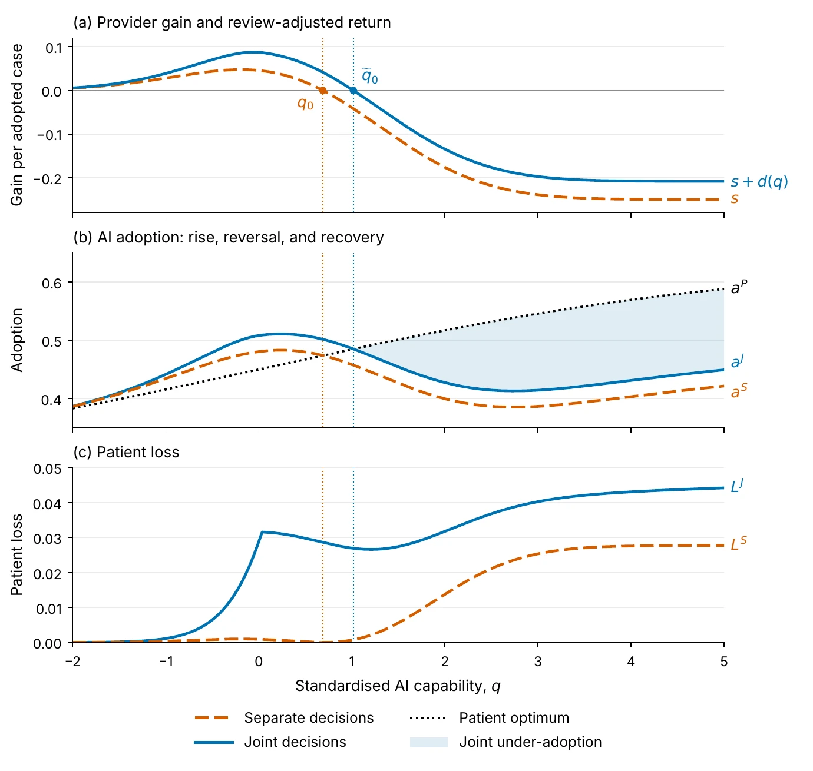

Our new working paper, [**"When Better Artificial Intelligence Widens the Adoption Gap in Health Care,"**](https://arxiv.org/abs/2611.20561) is now on arXiv. It is joint work with [Jonas Fooken](https://researchers.mq.edu.au/en/persons/jonas-fooken/) (Macquarie University Centre for the Health Economy) and [Metin Uyanik](https://sites.google.com/view/metinuyanik) (School of Economics, The University of Queensland).

The motivating puzzle is simple: in health care, you might expect better artificial intelligence to make adoption easier. Yet provider groups often welcome AI tools that help them do their work while resisting tools that can perform services autonomously without a paid human review. Under fee-for-service payment, for instance, assisting with image preparation or measurements lowers a clinician's cost while leaving the billed interpretation intact, whereas autonomous interpretation can replace the billed service altogether.

In the paper, we build a political-economy model of how provider influence shapes two policy decisions:
1. **Adoption ($a \in [0, 1]$):** the share of cases in which a payer switches coverage to care using AI.
2. **Review requirements ($h \ge 0$):** the expected number of paid professional reviews that must accompany AI when it is used in clinical care.

### From support to opposition

Using a task-based microfoundation, we track how provider gains change as AI capability ($q$) improves. At lower capability, AI mainly assists with component tasks, generating cost savings $B(q)$ for providers while leaving paid reviews unchanged. At higher capability, AI begins to support autonomous use that displaces paid reviews $x(q)$, each of which earns the provider a margin $\theta > 0$.

Provider gain per adopted case is therefore:

$$
s(q) = B(q) - \theta x(q).
$$

As long as the marginal assistance saving per displaced review exceeds the review margin, provider gains increase with AI capability. Once further improvements displace more review income than they add in savings, provider gains turn downward. If eventual lost review income exceeds full assistance savings, providers switch from supporting adoption to opposing it once AI crosses a capability threshold $q_0$. Panel (a) of the figure below shows this rise and fall.

This creates a clear selection effect across technologies: opposition begins earlier for AI that displaces more paid reviews, and later for assistive AI that yields larger provider cost savings or has a wider capability gap between assistance and autonomy.

### Why better AI can widen the adoption gap

Following Grossman and Helpman (1994), we consider a payer or policymaker who weighs provider gains against patient value when choosing policy under two institutional setups:

- **Separate decisions:** An independent body sets the review requirement at the patient optimum, while the influenced policymaker controls adoption. Once providers oppose sufficiently capable AI ($q > q_0$), their opposition leads to **under-adoption** relative to what patients would choose. Crucially, each further improvement in AI capability displaces more review income than it saves, so **the marginal patient value forgone grows as AI improves**.
- **Joint decisions:** When the influenced policymaker controls both adoption and review requirements, it can keep providers on board by mandating **excess reviews** above the patient optimum. Requiring paid reviews alongside AI compensates providers for displaced income and expands adoption, delaying under-adoption, but patients end up paying for reviews they would not choose to buy across every adopted case. In our quadratic patient-value example, setting review requirements independently at the patient optimum produces smaller total patient losses unless under-adoption is severe.

*Figure 1 (from the paper): (a) provider gain per adopted case, (b) adoption under separate and joint decisions relative to the patient optimum, and (c) patient losses, as standardised AI capability $q$ rises. Dotted vertical lines mark the onset of under-adoption under separate ($q_0$) and joint ($\widetilde{q}_0$) decisions.*

In panel (b), adoption rises with capability at first, then reverses once providers turn against the technology, and only partly recovers, so the gap to the patient optimum keeps widening. Panel (c) shows that separate decisions leave patients better off than joint decisions at every capability level in this example.

### Payment rules matter

A central implication of the model is that resistance to autonomous AI is tied directly to how providers are paid. When providers are paid per review ($\theta > 0$), autonomous AI threatens review margins and triggers opposition or excess review mandates. When providers are salaried or paid a fixed amount per case, replacing a review does not take away a per-review fee. Under fixed per-case payment, provider influence instead pushes review requirements below the patient optimum.

More broadly, evaluating AI policy in health care requires looking at both **whether AI is covered** and **what review requirements are attached to it**. Broad adoption does not guarantee alignment with patient value if it comes bundled with mandatory reviews that patients would not otherwise buy.

[arXiv](https://arxiv.org/abs/2611.20561) | [PDF](https://arxiv.org/pdf/2611.20561) | [DOI](https://doi.org/10.48550/arXiv.2611.20561)
